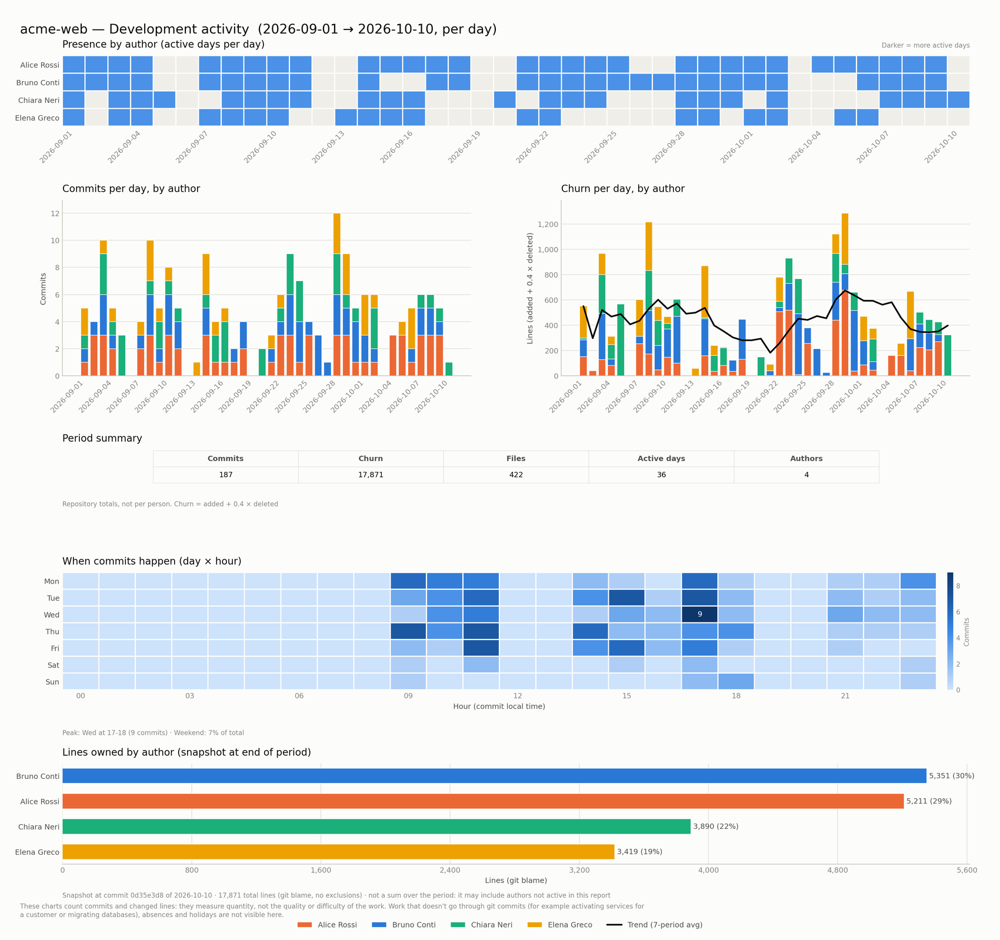
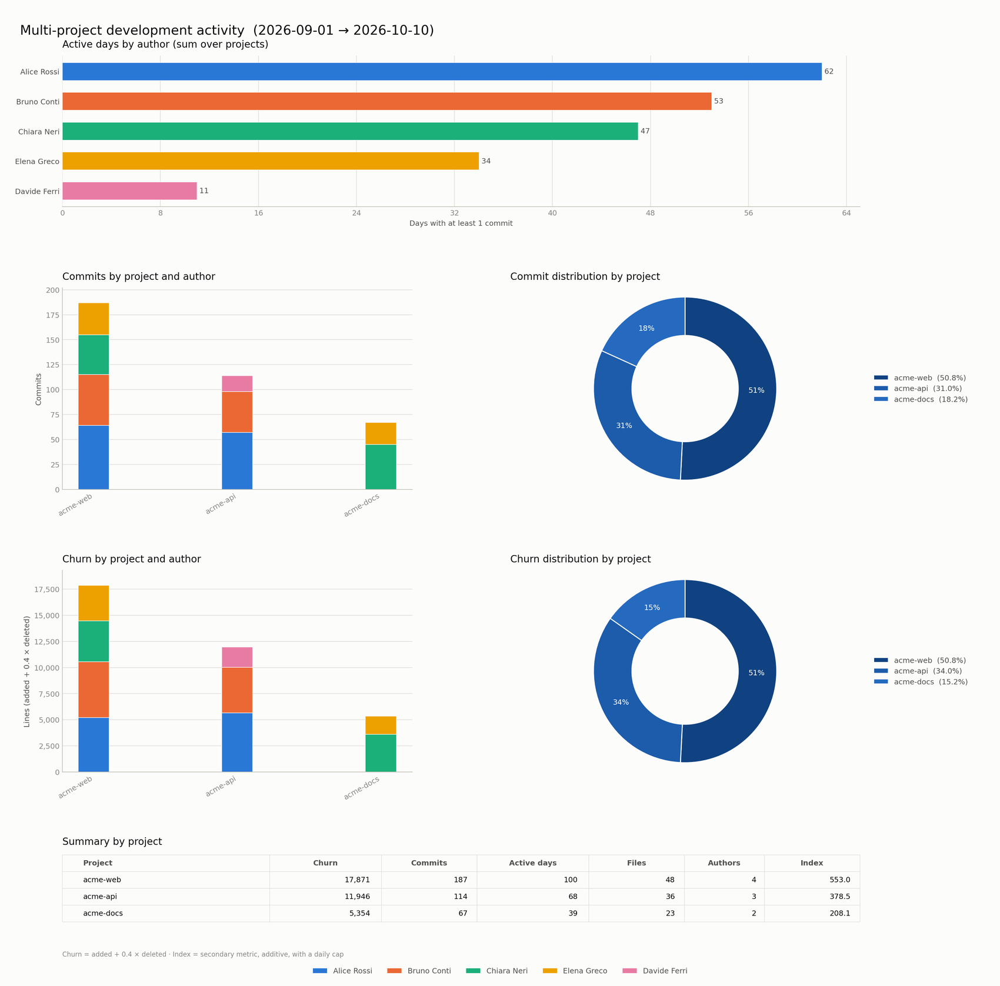

# Git Stats Collector - Complete Documentation

**English** · [Italiano](README.it.md)

A complete system for analyzing and visualizing Git statistics, available in two versions: **single repository** and **multi-repository**.



*Single-repository report. Generated from a synthetic repository (fictional authors). Charts are available in English and Italian (see [Chart language](#chart-language)).*



*Multi-repository report, same synthetic data split across three projects.*

## Table of Contents

- [📦 Installation](#-installation) · [🚀 Quick Start](#-quick-start)
- [Components](#components)
- [📊 Single Repository Version](#-single-repository-version) · [🌐 Remote Repositories](#-remote-repositories-analyzing-a-git-url)
- [🗂️ Multi-Repository Version](#-multi-repository-version) · [Multi-Repository Practical Examples](#multi-repository-practical-examples)
- [🔄 Comparison of the Two Versions](#-comparison-between-the-two-versions)
- [📋 Combined Use Cases](#-combined-use-cases) · [🎨 Interpreting the Charts](#-interpreting-the-charts)
- [🚨 Troubleshooting](#-troubleshooting) · [💡 Tips & Best Practices](#-tips--best-practices)
- [🔧 Customization](#-customization) · [📈 Calculated Metrics](#-calculated-metrics) · [🎯 Interpreting the Data](#-interpreting-the-data)
- [❓ FAQ](#-faq) · [🚀 Simplified Commands (gitstats/gitstats-multi)](#-simplified-commands-gitstats--gitstats-multi)
- [🧩 VS Code Extension](#-vs-code-extension)

---

## 📦 Installation

### 1. Download the project

```bash
git clone https://github.com/minnogit/git-activity-reports.git ~/git-activity-reports
cd ~/git-activity-reports
chmod +x *.sh *.py
```

Alternatively, on Debian/Ubuntu you can install the **`.deb` package** from the repository's Releases
page: it sets everything up in `/usr/local/bin` (including the `gitstats`/`gitstats-multi` commands) —
in that case you can skip the rest of this section and go straight to the [Quick Start](#-quick-start).

### 2. Requirements

**Bash scripts:**

- Bash 4.0+
- Git installed and configured
- Access to the repositories to analyze
- `date` command with `-d` support (GNU coreutils)

**Python scripts** (one of the three options):

```bash
sudo apt update
sudo apt install python3 python3-pip python3-pandas python3-matplotlib git
```

```bash
pip install pandas matplotlib numpy
```

```bash
python3 -m venv git-activity-env
source git-activity-env/bin/activate
pip install pandas matplotlib
```

### 3. Make the scripts callable from any folder (recommended)

The scripts must be run **in the folder of the repository you want to analyze** (e.g. `cd ~/projects/backend`),
not in the folder where you downloaded them in step 1 — which is why it is convenient to add them to the `PATH` instead
of typing the full path every time:

```bash
echo 'export PATH="$HOME/git-activity-reports:$PATH"' >> ~/.bashrc
source ~/.bashrc
```

From here on, from any folder:

```bash
cd ~/projects/backend
git_stats_collector.sh 2025-11-01 2025-11-30 json | python3 plot_git.py
```

**Without this step**, you will have to invoke the scripts with their full path, e.g.
`~/git-activity-reports/git_stats_collector.sh ...` (or `cd ~/git-activity-reports` and use `./`,
but only if you are analyzing that same folder).

> ⚠️ **If you have already installed a previous version in `/usr/local/bin`** (by hand or via the
> `.deb` package), those are **copies**: the `PATH` finds them before the repository, so
> you will keep running the old code even after a `git pull`. Check with
> `command -v plot_git.py` and update all the files together — collector and plotter must be
> the same version, because the JSON is a contract between them:
>
> ```bash
> cd ~/git-activity-reports
> sudo install -m 755 git_stats_collector.sh git_multiproject_stats_collector.sh \
>   plot_git.py plot_multiproject.py /usr/local/bin/
> sudo install -m 755 gitstat.sh /usr/local/bin/gitstats
> sudo install -m 755 gitstat-multi.sh /usr/local/bin/gitstats-multi
> ```

### 4. (Optional) Even shorter commands: `gitstats` / `gitstats-multi`

One more step, described in [🚀 Simplified Commands](#-simplified-commands-gitstats--gitstats-multi)
below, installs `gitstats`/`gitstats-multi`: a single command in place of the collector + plot pipe
(`gitstats 2025-11-01 2025-11-30` instead of `git_stats_collector.sh 2025-11-01 2025-11-30 json | python3 plot_git.py`).
These are the commands used in the Quick Start examples below.

---

## 🚀 Quick Start

### Which command should I use?

| I want... | Command |
| --- | --- |
| The **day-by-day** detail of ONE repository, over a few weeks/a month (I am already inside its folder) | `git_stats_collector.sh` |
| The **aggregated total** of one or more repositories over a long period (months/quarters) | `git_multiproject_stats_collector.sh` |
| To **compare multiple repositories** with each other (portfolio, team, microservices) | `git_multiproject_stats_collector.sh` |
| To analyze a repository that **I have not cloned locally yet** (only the URL) | both accept a Git URL — see [Remote Repositories](#-remote-repositories-analyzing-a-git-url) |

> The daily chart of `git_stats_collector.sh` loses readability over long periods (one bar per
> day) — details and alternatives in the [Single Repository Version](#-single-repository-version) section.

### The commands you will use most often

The commands below (`gitstats`, `gitstats-multi`) are the wrappers installed with step 4 of
[📦 Installation](#-installation) — if you have not installed them yet, or you only did step 3
(scripts in the `PATH`), use the "without wrappers" variant further below.

**With `gitstats`/`gitstats-multi` installed:**

```bash
# 1. Daily report of a repository (run inside its folder), with chart
cd ~/projects/backend
gitstats 2025-11-01 2025-11-30
# -> generates git_stats.png

# 2. Same report, filtered by author (name or email)
gitstats 2025-11-01 2025-11-30 "Mario Rossi"
gitstats 2025-11-01 2025-11-30 mario.rossi@example.com

# 3. Comparison across multiple repositories (local and/or remote), with chart
gitstats-multi 2025-11-01 2025-11-30 ~/projects/repoA ~/projects/repoB
# -> generates git_activity_multi_project_report_<start>_<end>.png (e.g. ..._2025-11-01_2025-11-30.png)

# 4. Same comparison, reading the project list from a file instead of the command line
gitstats-multi --file project_list.txt 2025-11-01 2025-11-30

# 5. Only one person's work across all projects (name or email)
gitstats-multi --author mario.rossi@example.com --file project_list.txt 2025-11-01 2025-11-30
```

**Without wrappers** (only the scripts in the `PATH`, step 3 of Installation — it does the same thing "by hand",
also useful for the `text` format or for saving the intermediate JSON, which the wrappers do not expose):

```bash
cd ~/projects/backend
git_stats_collector.sh 2025-11-01 2025-11-30 json | python3 plot_git.py
git_multiproject_stats_collector.sh 2025-11-01 2025-11-30 ~/projects/repoA ~/projects/repoB \
  | python3 plot_multiproject.py
```

### Parameters at a glance

| | `git_stats_collector.sh` | `git_multiproject_stats_collector.sh` |
| --- | --- | --- |
| Syntax | `[options] <START> <END> [format] [author]` | `[options] <START> <END> [paths...]` |
| Where to run it | Inside the repo folder (or with `--repo`) | From any folder |
| `START` / `END` | `YYYY-MM-DD`, required | `YYYY-MM-DD`, required (also via `--start`/`--end`) |
| 3rd positional argument | `text` (default) or `json` | — (repository path/URL) |
| 4th positional argument | author name or email (optional, filters) | — |
| Filter by author | 4th positional argument | `--author <name\|email>` |
| Repository list | not applicable (a single repo per run) | paths/URLs at the end of the command, or `--file list.txt` |
| Update from remote | only with `--fetch` | only with `--fetch` |
| Repository via URL | `--repo <url>` | pass the URL as a path (positional or a line of `--file`) |
| Output format | `text` or `json` on stdout | always `json` on stdout |
| Chart (piped) | `python3 plot_git.py` → 4-6 panel report | `python3 plot_multiproject.py` → 6 panel report |

Full details of every option below: [Single Repository Version](#-single-repository-version), [Multi-Repository Version](#-multi-repository-version).

---

## Components

### Single Repository Version

- **`git_stats_collector.sh`** - Analyzes one repository at a time with daily detail
- **`plot_git.py`** - Generates a base 4-panel report (active days, commits over time, churn over time, summary table) plus two optional ones

### Multi-Repository Version

- **`git_multiproject_stats_collector.sh`** - Analyzes multiple repositories at once
- **`plot_multiproject.py`** - Generates a 6-panel report comparing projects (active days, commits and churn by project/author, commit and churn distribution, summary table)

The grouping of authors via `git-activity-aliases.json` (author aliases) is handled by the **collectors**
(not by the plotters), because it must be applied to the raw data before any aggregation.

---

## 📊 Single Repository Version

### Overview

Analyzes a single Git repository with **daily** detail, ideal for:

- Personal activity reports
- Sprint analysis on a specific project
- Daily team monitoring on a repository

**⚠️ Chart limitation over long ranges:** `plot_git.py` draws one bar for each day of the
period. Over a range of a few weeks the chart is readable; over several months (e.g. a semester)
the bars become too narrow/numerous and the chart loses readability. For long periods:

- narrow the range to a few weeks/a month at a time, or
- use `git_multiproject_stats_collector.sh` (aggregated, not daily — see the dedicated section further below)
  if you only care about the total for the period and not the day-by-day detail, or
- split the long period into multiple calls (one per week/month) and generate a chart for each,
  as in the ["Multi-Level Monthly Analysis"](#multi-level-monthly-analysis) example.

### Syntax

```bash
./git_stats_collector.sh <START_DATE> <END_DATE> [format] [author]
```

**Note:** The collectors (`git_stats_collector.sh` and `git_multiproject_stats_collector.sh`) support grouping authors through an optional `git-activity-aliases.json` file. This file lets you group several Git author names under a single common name, which is useful when the same developer has contributed under different names. Example:

```json
{
  "Mario Rossi": "Mario R.",
  "Rossi M.": "Mario R.",
  "mario.rossi@example.com": "Mario R.",
  "Giulia Verdi": "Giulia V."
}
```

The configuration file can be placed in several locations and will be searched for in this order:

1. In the current directory (`./git-activity-aliases.json`)
2. In the application-specific XDG configuration directory (`~/.config/git-activity-reports/git-activity-aliases.json`)
3. In the generic XDG configuration directory (`~/.config/git-activity-git-activity-aliases.json`)
4. **Next to the scripts** (`<scripts-folder>/git-activity-aliases.json`) — useful because the
   collector runs *inside the repository to analyze*, where `.` is a different folder: a file
   placed next to the scripts thus applies to all repositories
5. In the system directory (`/etc/git-activity-reports/git-activity-aliases.json`)

If no configuration file exists, the script will keep working normally without grouping authors.

**Identity by email and `.mailmap`.** A key containing `@` is an **email** (compared case-insensitively) and takes precedence over a name alias. Use it when the same person appears under different names but the same email, or under several emails. There is no automatic "same email = same person" merge: shared emails, `noreply` addresses and bots would merge different people, so merging is always explicit. Author names and emails are read with `%aN`/`%aE`, which honor a repository `.mailmap`: if you have one, git applies it before the aliases.

## 🌐 Remote Repositories (analyzing a Git URL)

Both `git_stats_collector.sh` (via `--repo <url>`) and `git_multiproject_stats_collector.sh` (as a
positional path or a line of `--file`) accept, in place of a local path, any Git URL
(`https://...`, `git://...`, `ssh://...` or the scp form `git@host:org/repo.git`).

**How it works:**

1. On first use, the repository is **cloned** into a visible (not hidden) folder under
   `$GIT_ACTIVITY_REPOS_DIR` (default: `~/repos`), using the last segment of the URL as the folder name
   (without `.git`).
2. On subsequent runs, if the folder already matches that URL (same `remote origin`), it is
   **reused** without cloning again — updating (`git fetch`) remains opt-in with `--fetch`, as for
   local repositories.
3. Since the folder is visible and ordinary (not a hidden bare clone), it can coincide with a repository
   you are already working on: if you had already cloned that project by hand into `~/repos/project-name`, the script
   recognizes it and reuses it (provided the `origin` matches the requested URL).

**Examples:**

```bash
# Single remote repository
./git_stats_collector.sh --repo https://github.com/org/repo.git 2025-11-01 2025-11-30 json | python3 plot_git.py

# Multi-repository: mix of URLs and local paths
./git_multiproject_stats_collector.sh 2025-11-01 2025-11-30 \
  https://github.com/org/backend.git ~/projects/frontend git@github.com:org/mobile.git \
  | python3 plot_multiproject.py

# Custom clone folder
GIT_ACTIVITY_REPOS_DIR=/data/git-mirrors ./git_multiproject_stats_collector.sh --file progetti.txt 2025-11-01 2025-11-30
```

**Folder name collisions:** if two different URLs would produce the same folder name (e.g. two
repositories both named `backend` on different hosts), the script **stops with an error** instead of
overwriting/mixing up the two repositories. To resolve it, assign a dedicated folder name to one of the
two URLs through an optional mapping file (required only in case of a collision):

`~/.config/git-activity-reports/git-activity-repos-map.json`

```json
{
  "https://github.com/org-a/backend.git": "backend-org-a",
  "https://gitlab.com/org-b/backend.git": "backend-org-b"
}
```

The keys must match exactly the URL passed on the command line/in the `--file` file.

### Parameters

| Position | Parameter     | Required | Description                     | Default |
| --------- | ------------- | ------------ | ------------------------------- | ------- |
| 1         | `DATA_INIZIO` | ✓            | Start date (YYYY-MM-DD)         | -       |
| 2         | `DATA_FINE`   | ✓            | End date (YYYY-MM-DD)           | -       |
| 3         | `formato`     | ✗            | Output format: `text` or `json` | `text`  |
| 4         | `autore`      | ✗            | Filter by author, **exact match**: name or email (if it contains `@`; with an email it includes the identities merged by the aliases). With a filter, ownership is not computed | all     |

### Available Options

| Option       | Argument      | Description                                                                                                                     |
| ------------ | ------------- | ------------------------------------------------------------------------------------------------------------------------------- |
| `--fetch`    | -             | Enables updating the repository with git fetch                                                                                  |
| `--repo`     | `<path\|url>` | Analyzes this repository instead of the current folder (see [Remote Repositories](#-remote-repositories-analyzing-a-git-url))   |
| `--no-ownership` | -         | Skips the ownership computation (git blame per file, `json` format only) — see [Interpreting the Charts](#-interpreting-the-charts) |
| `-h, --help` | -             | Shows the help                                                                                                                  |

### Examples - Single Repository

#### 1. Text report for all authors (total mode)

```bash
cd ~/projects/backend
./git_stats_collector.sh 2025-11-01 2025-11-30
```

**Output:**

```txt
Generazione report dal 2025-11-01 al 2025-11-30...

## Report: TOTALE
---------------------------------------------------------------------------------------
Giorno     Data            Commit     Righe Tot.       Aggiunte         Rimosse
---------------------------------------------------------------------------------------
Lun        2025-11-04          3            450            280            170
Mar        2025-11-05          5            892            650            242
Mer        2025-11-06          2            156            100             56
---------------------------------------------------------------------------------------
TOTALE:                       10           1498           1030            468
```

#### 2. Text report for a specific author

```bash
./git_stats_collector.sh 2025-11-01 2025-11-30 text "Mario Rossi"
```

#### 3. JSON for graphical visualization (all authors)

```bash
./git_stats_collector.sh 2025-11-01 2025-11-30 json | python3 plot_git.py
```

**Generates:** `git_stats.png` with a daily stacked bar chart

#### 4. JSON for a single author

```bash
./git_stats_collector.sh 2025-11-01 2025-11-30 json "Laura Bianchi"
```

**JSON output:**

```json
[
  {
    "author": "Laura Bianchi",
    "total_commits": 15,
    "daily_data": [
      {"day": "Monday", "date": "2025-11-04", "commits": 3, "lines": 450, "added": 280, "deleted": 170},
      {"day": "Tuesday", "date": "2025-11-05", "commits": 5, "lines": 892, "added": 650, "deleted": 242}
    ]
  }
]
```

#### 5. Saving data for later analysis

```bash
# Generate and save JSON
./git_stats_collector.sh 2025-11-01 2025-11-30 json > novembre.json

# Visualize later
cat novembre.json | python3 plot_git.py

# Or inspect the data
cat novembre.json | jq '.[] | {author, total_commits}'
```

#### 6. With explicit repository update

```bash
# Runs git fetch before the analysis
./git_stats_collector.sh --fetch 2025-11-01 2025-11-30 json | python3 plot_git.py

# With text format
./git_stats_collector.sh --fetch 2025-11-01 2025-11-30 text "Mario Rossi"
```

---

## 🗂️ Multi-Repository Version

### Overview

Analyzes multiple repositories at once with statistics **per project and author** (with daily
detail), ideal for:

- Comparing activity across different projects
- Reports for teams distributed across multiple repositories
- Full portfolio analysis

**Important notes:**

- Merge commits are excluded from the statistics
- **No file is excluded from the churn** (node_modules, lock files, generated code included) — see
  [Why we don't exclude generated/vendored code (and why we used to)](#why-we-dont-exclude-generatedvendored-code-and-used-to)
- Total lines are calculated as: added + deleted

### Full Syntax

```bash
./git_multiproject_stats_collector.sh [OPTIONS] <START_DATE> <END_DATE> [paths...]
```

### Available Options

| Option       | Argument  | Description                                            |
| ------------ | --------- | ------------------------------------------------------ |
| `--file`     | `<file>`  | Reads the repository paths from a file (one per line)  |
| `--start`    | `<date>`  | Period start date (format: YYYY-MM-DD)                 |
| `--end`      | `<date>`  | Period end date (format: YYYY-MM-DD)                   |
| `--fetch`    | -         | Enables updating the repositories with git fetch       |
| `--author`   | `<name\|email>` | Only one person's work, exact match: display name or email (if it contains `@`; with an email it includes the identities merged by the aliases) |
| `-h, --help` | -         | Shows the help                                         |

**Note:** each path (positional or a line of `--file`) can also be a Git URL, not just a local
path — see [Remote Repositories](#-remote-repositories-analyzing-a-git-url).

---

## Multi-Repository Practical Examples

### 1. Analyzing specific repositories

```bash
./git_multiproject_stats_collector.sh 2025-11-01 2025-11-30 ~/progetti/repoA ~/progetti/repoB
```

**Result:** Analyzes `repoA` and `repoB` for all of November 2025.

---

### 2. Repositories from a configuration file

**Create the file `progetti.txt`:**

```txt
~/progetti/backend
~/progetti/frontend
/var/www/api-service
# This is a comment - it will be ignored
~/workspace/mobile-app
```

**Run the script:**

```bash
./git_multiproject_stats_collector.sh --file progetti.txt 2025-11-01 2025-11-30
```

---

### 3. Dates as options (flexible order)

```bash
# Dates specified with flags
./git_multiproject_stats_collector.sh --start 2025-11-01 --end 2025-11-30 ~/repo1 ~/repo2

# Mixing file and dates with flags
./git_multiproject_stats_collector.sh --file progetti.txt --start 2025-11-01 --end 2025-11-30
```

---

### 4. Full pipeline with visualization

```bash
# Generate JSON and create charts
./git_multiproject_stats_collector.sh 2025-11-01 2025-11-30 ~/repo1 ~/repo2 | python3 plot_multiproject.py
```

### 5. With explicit repository update

```bash
# Runs git fetch before the analysis
./git_multiproject_stats_collector.sh --fetch --file progetti.txt 2025-11-01 2025-11-30

# Or with specific repositories
./git_multiproject_stats_collector.sh --fetch 2025-11-01 2025-11-30 ~/repo1 ~/repo2
```

**Output:** File `git_activity_multi_project_report_<start>_<end>.png` with 6 panels.

---

### 5. Saving intermediate data

```bash
# Save JSON for later analysis
./git_multiproject_stats_collector.sh --file progetti.txt 2025-11-01 2025-11-30 > dati_novembre.json

# Use the saved data
cat dati_novembre.json | python3 plot_multiproject.py
```

---

## 🔄 Comparison Between the Two Versions

| Feature              | Single Repository                | Multi-Repository                     |
| -------------------- | -------------------------------- | ------------------------------------ |
| **Granularity**      | Daily                            | Aggregated per project               |
| **Scope**            | One repository at a time         | Multiple at once                     |
| **Output format**    | text/json                        | json (only)                          |
| **Author filter**    | Yes, via parameter               | No (shows everyone)                  |
| **Charts generated** | 1 (stacked bar)                  | 3 (bar, donut, ranking)              |
| **Typical use**      | Sprint review, personal analysis | Portfolio review, project comparison |
| **Execution**        | Inside the repo folder           | From any location                    |

### When to Use Which Version?

**Use Single Repository if:**

- You want to see activity **day by day**
- You are interested in a **specific project**
- You want readable text reports
- You need to filter by a specific author

**Use Multi-Repository if:**

- You need to compare **multiple projects**
- You are interested in the **distribution of work** across repositories
- You want an **overview** of the team
- You work on a microservices ecosystem

---

## 📋 Combined Use Cases

### Complete Sprint Retrospective

```bash
# 1. General overview of all the team's projects
./git_multiproject_stats_collector.sh --file team-repos.txt 2025-11-15 2025-11-30 \
  | python3 plot_multiproject.py
  
# 2. Daily detail on the main project
cd ~/progetti/backend
./git_stats_collector.sh 2025-11-15 2025-11-30 json | python3 plot_git.py

# 3. Text report for a specific developer
./git_stats_collector.sh 2025-11-15 2025-11-30 text "Mario Rossi"
```

### Multi-Level Monthly Analysis

```bash
# November: general view
./git_multiproject_stats_collector.sh 2025-11-01 2025-11-30 \
  ~/backend ~/frontend ~/mobile > novembre_overview.json

# Weekly detail on frontend
cd ~/frontend
./git_stats_collector.sh 2025-11-01 2025-07 json > week1.json
./git_stats_collector.sh 2025-11-08 2025-11-14 json > week2.json
./git_stats_collector.sh 2025-11-15 2025-11-21 json > week3.json
./git_stats_collector.sh 2025-11-22 2025-11-30 json > week4.json

# Visualize week by week
for week in week*.json; do
  echo "Analisi $week"
  cat $week | python3 plot_git.py
  mv git_stats.png "${week%.json}_chart.png"
done
```

### Q3 vs Q4 Performance Comparison

```bash
# Q3: Multi-repo
./git_multiproject_stats_collector.sh --file all-repos.txt 2025-07-01 2025-09-30 \
  | python3 plot_multiproject.py
mv git_activity_multi_project_report_*.png q3_portfolio.png

# Q4: Multi-repo
./git_multiproject_stats_collector.sh --file all-repos.txt 2025-10-01 2025-12-31 \
  | python3 plot_multiproject.py
mv git_activity_multi_project_report_*.png q4_portfolio.png

# Q4 detail on a strategic project
cd ~/progetti/strategic-project
./git_stats_collector.sh 2025-10-01 2025-12-31 json | python3 plot_git.py
mv git_stats.png q4_strategic_daily.png
```

---

## 🎨 Interpreting the Charts

Both reports place the same activity metrics side by side instead of a single
score, plus a table with the exact values (see [Metriche Calcolate](#-calculated-metrics)
for why). The single repository report has a base of 4 panels plus two optional ones;
the multi-repository one always has 6.

### Chart language

The text drawn in the charts (titles, axes, table, legend) is available in **English** and
**Italian**. The plotters choose the language in this order:

1. the `--lang en` / `--lang it` option of `plot_git.py` / `plot_multiproject.py`;
2. the `GIT_ACTIVITY_LANG` environment variable (`en` or `it`);
3. the system locale (`LC_ALL`, `LC_MESSAGES`, `LANG`): a value starting with `it` gives Italian;
4. otherwise English.

```bash
./git_stats_collector.sh 2025-11-01 2025-11-30 json | python3 plot_git.py --lang en
GIT_ACTIVITY_LANG=it gitstats 2025-11-01 2025-11-30
```

The messages printed on the terminal stay in Italian. The VS Code extension passes the
VS Code display language.

### Single Repository Report (`git_stats.png`)

Panels are ordered by how reliable they are, not by how
impressive they look: churn comes last, not first (see
[Metriche Calcolate](#-calculated-metrics) for why):

| Panel | What it shows |
|---|---|
| 1. Active days by author | Full width, at the top: the most robust metric, continuity of contribution |
| 2. Commits over time, per author | Stacked bars. Delivery frequency, independent of size |
| 3. Churn over time, per author | Stacked bars + trend line (moving average). Volume of change, **with no exclusions**. Placed next to panel 2 for direct comparison |
| 4. Summary per author | Table with churn, commits, active days, files, index |

**Adaptive granularity:** the time axis adapts automatically to the period, because
one bar per day becomes unreadable over long intervals:

| Requested period | Granularity |
|---|---|
| ≤ 45 days | daily |
| 46–250 days | weekly |
| > 250 days | monthly |

**Typical insights:** peaks before releases, periods of inactivity, distribution of the
workload. Comparing panels 2 and 3 is often more informative than either one taken alone:
many commits with little churn indicates small-step iteration, the opposite indicates
large, infrequent changes (or, since churn excludes nothing, even just a very large
generated/vendored file — always check what is behind a peak).

**5. When commits happen (day × hour)** — additional panel, present only if
the JSON has the `punch_card` field (absent from JSON produced by earlier versions of the
collector: the panel is skipped, not left empty). It is a grid of day of the
week × hour of the day, colored by number of commits — **descriptive, not
evaluative**: it tells *when* activity happens, not *how much* work was done. Commit
timestamps are not a reliable proxy for hours worked, so we do not try to
estimate them; that is why it is not a fourth metric in the order of reliability above, it is
a different kind of information. The hour is the local one recorded in the commit (the author's
time zone, no conversion to a common time zone).

**6. Lines owned per author (ownership)** — additional panel, present only if the
JSON has the `ownership` key (absent from JSON produced with `--no-ownership` or by
earlier versions of the collector: the panel is skipped, not left empty). Unlike
all the other panels, which are time series of activity in the
requested period, this is a **snapshot**: how many lines of the repository, according to
`git blame`, were last written by each author at the LAST COMMIT ≤ end
date (not the current HEAD, for reproducibility). It can therefore show authors who were never active
in the report period, if they still have code present that nobody has touched since.
No exclusion of generated/vendored files (same choice made for churn — see
[Metriche Calcolate](#-calculated-metrics)): consistent with the default behavior of
git-fame, which leaves exclusion as a manual option (`--excl`) and does not apply it
automatically. The computation requires one `git blame` per file (one operation per file is
unavoidable) and can be expensive on very large repositories — `--no-ownership` skips it.

### Multi-Repository Report

Same principle of the order of reliability, organized **one row per metric**: row
2 is all about commits, row 3 all about churn. Within each row, bars and
donut tell the same story at two levels of detail — where activity
is concentrated, and the share of the total.

| Panel | What it shows |
|---|---|
| 1. Active days by author | Continuity of contribution, summed across projects. The most reliable, alone at the top |
| 2. Commits per project and author | Stacked bars. More reliable than churn (see below) |
| 3. Commit distribution | Share per project (donut; 100% bar if projects are < 3) |
| 4. Churn per project and author | Stacked bars, **with no exclusions**. Below commits, not next to them: it is the least indicative metric |
| 5. Churn distribution | Same treatment as panel 3, for churn |
| 6. Summary per project | Table with churn, commits, active days, files, authors, index |

A project can have high churn and a low index (few very large commits, or a very
large generated client) or the opposite (activity spread over many days): that is the
difference a single score would hide. To read the two metrics **on the
same project** use the summary table, not an eyeball comparison between panels
2 and 4: each panel sorts projects by its own total, so the same position
on the X axis can correspond to different projects in the two charts (and that is exactly
what happens when a project has few commits but huge churn — the case you would
most want to compare). An honest comparison would require a dedicated panel,
for example churn per commit of each project: it is not yet present in the report.

**Colors:** each author has a fixed color, consistent across all panels and assigned in
palette order, not by rank. Beyond 8 authors the tail is merged into "Other"
instead of generating new hues (indistinguishable for people with color vision deficiency).
The palette is verified for CVD separation and contrast.

---

## 📊 Output Format Details

The JSON is a **contract** between the bash script and the Python one: if you update a collector
you must also update the corresponding plotter (and vice versa). The plotters also accept
the previous format, so that previously saved JSON files can be reprocessed.

### Single Repository JSON

```json
{
  "metadata": {
    "start_date": "2025-11-01",
    "end_date": "2025-11-30",
    "project": "backend",
    "date_basis": "author"
  },
  "data": [
    {
      "author": "Mario Rossi",
      "total_commits": 24,
      "daily_data": [
        {
          "day": "Monday",
          "date": "2025-11-04",
          "commits": 3,
          "lines": 450,
          "added": 280,
          "deleted": 170,
          "files": 6
        }
      ],
      "punch_card": [
        { "weekday": 0, "hour": 10, "commits": 2 }
      ]
    }
  ],
  "ownership": {
    "ref_commit": "abcdef0123...",
    "ref_date": "2025-11-30",
    "total_lines": 48213,
    "by_author": [
      { "author": "Mario Rossi", "lines": 30112, "pct": 62.45 }
    ]
  }
}
```

**Only days/cells with activity** are listed: the plotter reconstructs the empty days
from the range in `metadata`, so time is not compressed in the chart.

`punch_card`: distribution of commits by day of the week (`weekday`, 0=Monday..
6=Sunday, Python `date.weekday()` convention) and hour (`hour`, 0-23, local time
recorded in the commit — no conversion to a common time zone), aggregated over the whole
requested period. Absent from JSON produced by earlier versions of the collector; in
that case the corresponding panel in the chart is skipped, not left empty.

`ownership` (absent with `--no-ownership`, or if no commit ≤ end date exists):
lines owned per author according to `git blame` at the LAST COMMIT ≤ end date — a
snapshot, not an aggregation over the period, so it can include authors who were never active in the
requested period. `ref_commit`/`ref_date` identify the reference commit;
`total_lines` is the total number of lines in the tree at that commit; `by_author` is sorted by
`lines` descending. No exclusion of generated/vendored files.

### Multi-Repository JSON

```json
{
  "metadata": {
    "start_date": "2025-11-01",
    "end_date": "2025-11-30",
    "date_basis": "author"
  },
  "data": [
    {
      "project": "backend",
      "author": "Mario Rossi",
      "commits": 24,
      "added": 3000,
      "deleted": 450,
      "lines": 3450,
      "files": 37,
      "active_days": 12,
      "daily_data": [
        { "date": "2025-11-04", "commits": 3, "added": 280, "deleted": 170, "files": 6 }
      ]
    }
  ]
}
```

**Fields:**

| Field | Meaning |
|---|---|
| `project` | Repository name (folder name) |
| `author` | Git author name, with aliases already applied |
| `commits` | Commits, excluding merges |
| `added` / `deleted` | Lines added / removed |
| `lines` | `added + deleted` (backward compatibility) |
| `files` | **Distinct** files touched in the period |
| `active_days` | Distinct days with at least 1 commit |
| `daily_data` | Daily detail, with distinct `files` **per day** |
| `date_basis` | `"author"`: days are attributed by author-date |

`daily_data` is necessary, not decorative: without it the index's anti-outlier
cap would be applied to the period aggregate and would saturate (see
[Metriche Calcolate](#-calculated-metrics)).

---

## Path File Format

The file specified with `--file` must follow these rules:

```txt
# Absolute paths
/home/utente/progetti/repo1
/var/www/progetto2

# Paths with tilde (expanded automatically)
~/workspace/backend
~/progetti/frontend

# Blank lines and comments are ignored
# TODO: add new-project

# ⚠️ Support for paths with spaces
/home/utente/My Projects/repo name
```

**Note:** the data collected from these paths is processed by `plot_multiproject.py`, which computes
churn, commits and active days plus a secondary composite index (see
[Metriche Calcolate](#-calculated-metrics)).

The `git-activity-aliases.json` file lets you group different Git author names under a single common name, useful when the same developer has contributed under different names. It is read by the **collectors**, which apply the aliases before aggregating. Example:

```json
{
  "Mario Rossi": "Mario R.",
  "Rossi M.": "Mario R.",
  "mario.rossi@example.com": "Mario R.",
  "Giulia Verdi": "Giulia V."
}
```

The configuration file can be placed in several locations and will be searched in this order:

1. In the current directory (`./git-activity-aliases.json`)
2. In the application-specific XDG configuration directory (`~/.config/git-activity-reports/git-activity-aliases.json`)
3. In the generic XDG configuration directory (`~/.config/git-activity-git-activity-aliases.json`)
4. **Next to the scripts** (`<scripts-folder>/git-activity-aliases.json`) — useful because the
   collector runs *inside the repository to be analyzed*, where `.` is a different folder: a file
   placed next to the scripts thus applies to all repositories
5. In the system directory (`/etc/git-activity-reports/git-activity-aliases.json`)

If no configuration file exists, the script will keep working normally without grouping authors.

**Identity by email and `.mailmap`.** A key containing `@` is an **email** (compared case-insensitively) and takes precedence over a name alias. Use it when the same person appears under different names but the same email, or under several emails. There is no automatic "same email = same person" merge: shared emails, `noreply` addresses and bots would merge different people, so merging is always explicit. Author names and emails are read with `%aN`/`%aE`, which honor a repository `.mailmap`: if you have one, git applies it before the aliases.

---

## JSON Output and Visualizations

The complete JSON format of both collectors, with the description of all fields, is
documented in [Output Format Details](#-output-format-details).
The composition of the panels of each report is described in
[Interpretazione dei Grafici](#-interpreting-the-charts).

---

## Common Use Cases

### Sprint Review

```bash
# Analysis of the sprint just ended (last 14 days)
./git_multiproject_stats_collector.sh --start 2025-11-15 --end 2025-11-30 \
  ~/team/backend ~/team/frontend ~/team/mobile | python3 plot_multiproject.py
```

### Monthly Report

```bash
# Whole team, all projects, last month
./git_multiproject_stats_collector.sh --file team-repos.txt 2025-11-01 2025-11-30 \
  > report_novembre.json

python3 plot_multiproject.py < report_novembre.json
```

### Quarterly Comparison

```bash
# Q3 vs Q4
./git_multiproject_stats_collector.sh 2025-07-01 2025-09-30 ~/repo1 ~/repo2 > q3.json
./git_multiproject_stats_collector.sh 2025-10-01 2025-12-31 ~/repo1 ~/repo2 > q4.json

# Analyze separately
python3 plot_multiproject.py < q3.json  # generates git_activity_multi_project_report_*.png
mv git_activity_multi_project_report_*.png q3_report.png

python3 plot_multiproject.py < q4.json
mv git_activity_multi_project_report_*.png q4_report.png
```

---

## Technical Notes

### Commits Considered

- **Included:** Standard commits with file changes
- **Excluded:** Merge commits (`--no-merges` flag)
- A single `git log` per repository: grouping by author and day happens in `awk`.
  Besides being much faster (previously a `git log` was launched for each day *for each
  author*), it avoids a real double-counting issue, described below.

### Author Attribution

The match on the author name is **exact**. `git log --author=<name>`, by contrast, matches by
substring: with two authors "Luca" and "Luca Bianchi", the latter's commits were
counted **also** for "Luca". Practical consequences:

- The `author` parameter requires the exact full name; if it finds no matches, the
  script lists the authors available in the period
- Names with special characters (parentheses, dots) are no longer interpreted as regex
- If the value contains `@` the filter compares the **email** (exact, case-insensitive, after a possible `.mailmap`) and also includes every identity that the aliases merge into the same display name
- With an author filter **ownership is not computed**: the panel would show the other authors and the `git blame` runs would be a cost with no benefit

### Date Handling

- Required format: `YYYY-MM-DD`, range inclusive at both ends
- Days are attributed based on the **author-date**, not the committer-date.
  git's `--since`/`--until` filter on the committer-date: a rebase or cherry-pick
  rewrites that date, so weeks of work could end up attributed to the day of the
  rebase. The exact filter on the period is applied after reading the log (git cannot
  filter by author-date), which is why `--since` is extended 31 days back.

### Files Considered

**All files, no exclusions** — `node_modules`, lock files, generated clients and
vendored libraries count like any other file in the churn. This is not an oversight:
see [Why we don't exclude generated/vendored code (and used to)](#why-we-dont-exclude-generatedvendored-code-and-used-to)
for the reason (in short: any directory-based exclusion can break git's
rename detection). If a specific repository has this kind of noise,
keep it in mind when reading the churn — it is the reason why it is the least indicative
of the three metrics in the report.

### Code Ownership (git blame)

Only for the `json` format of `git_stats_collector.sh`, can be disabled with
`--no-ownership`. It answers a different question from the rest of the report: not "who
worked during the period" (time series) but "who owns the code present in the tree",
according to `git blame`, at the **last commit ≤ end date** (not the current HEAD — this makes the
result reproducible when re-running the same report in the future). No automatic
exclusion of generated/vendored files, the same choice made for the churn and consistent
with git-fame's default behavior.

One `git blame` per file is unavoidable (git offers no equivalent command for the whole
tree in a single invocation): the collector parallelizes the calls with `xargs -P`
(up to `nproc` processes), measured ~6x faster than a sequential run on a
real repository of over 3000 files. On very large repositories the cost can remain
significant: use `--no-ownership` to skip it.

### Date Handling

- Required format: `YYYY-MM-DD`
- Inclusive range: includes both the start and the end date
- Times considered: `00:00:00` (start) - `23:59:59` (end)

### Performance

For very large repositories (>10K commits), the analysis can take a few minutes. Consider:

- Reducing the time range
- Analyzing repositories in separate batches

### Repository Updates

By default, repositories are **not updated** automatically with git fetch. To enable an explicit update, use the `--fetch` option:

**Multi-repository:**

```bash
./git_multiproject_stats_collector.sh --fetch --file repos.txt 2025-11-01 2025-11-30
```

**Single repository:**

```bash
./git_stats_collector.sh --fetch 2025-11-01 2025-11-30 json
```

---

## 🚨 Troubleshooting

### Common Problems - Installation

#### Charts look identical to before after an update

**Cause:** `/usr/local/bin` contains **copies** of a previous version (installed by
hand or from the `.deb` package), and the `PATH` finds them before the repository. This typically happens
with `gitstats`/`gitstats-multi`, which resolve collector and plotter from the `PATH`.

**Diagnosis and solution:**

```bash
command -v plot_git.py          # if it prints /usr/local/bin/..., you are using the copy
grep -c DELETED_WEIGHT "$(command -v plot_git.py)"   # 0 = old version

cd ~/git-activity-reports
sudo install -m 755 git_stats_collector.sh git_multiproject_stats_collector.sh \
  plot_git.py plot_multiproject.py /usr/local/bin/
sudo install -m 755 gitstat.sh /usr/local/bin/gitstats
sudo install -m 755 gitstat-multi.sh /usr/local/bin/gitstats-multi
```

Update **all** files together: the JSON is a contract between collector and plotter.

#### `SyntaxWarning: 'return' in a 'finally' block`

**Cause:** warning emitted by `pyparsing`, a matplotlib dependency, during import.
It does not concern these scripts.

**Solution:** none, it is harmless. If the message is annoying, use `python3 -W ignore::SyntaxWarning`.
The command succeeded if it prints `Grafico generato con successo: ...` ("chart generated successfully").

### Common Problems - Single Repository

#### "Nessun dato per l'autore ... (il match è esatto)" ("No data for the author ... (the match is exact)")

**Cause:** since version 2.0 the author filter requires the **full, exact** name; previously
it was a substring match (which however caused double counting between nested names).

**Solution:** the script itself lists the authors available in the period — copy the name from
that list. If you use aliases, both the original Git name and the display name work: the
requested name is first resolved through the alias map (the script tells you, e.g.
`Autore "Michele Innocenti" risolto in "minnogit" tramite gli alias`, meaning: author "Michele Innocenti" resolved to "minnogit" via aliases). The filter also accepts an **email** (e.g. `mario.rossi@example.com`): the comparison is exact but case-insensitive.

#### "Non sei in un repository Git" ("You are not in a Git repository")

**Cause:** Script run outside a Git folder  
**Solution:**

```bash
cd /path/to/your/repo
./git_stats_collector.sh 2025-11-01 2025-11-30
```

#### "L'input non sembra un JSON valido" ("The input does not look like valid JSON")

**Cause:** You used the `text` format instead of `json` with plot_git.py  
**Solution:**

```bash
# ✗ Wrong
./git_stats_collector.sh 2025-11-01 2025-11-30 text | python3 plot_git.py

# ✓ Correct
./git_stats_collector.sh 2025-11-01 2025-11-30 json | python3 plot_git.py
```

#### Author with spaces does not work

**Cause:** Author name not quoted  
**Solution:**

```bash
# ✗ Wrong
./git_stats_collector.sh 2025-11-01 2025-11-30 text Mario Rossi

# ✓ Correct
./git_stats_collector.sh 2025-11-01 2025-11-30 text "Mario Rossi"
```

#### "Nessun dato trovato per generare il grafico" ("No data found to generate the chart")

**Cause:** JSON contains only "TOTALE" (total) entries or there is no activity in the period  
**Solution:**

```bash
# Check that there are commits in the period
git log --since="2025-11-01" --until="2025-11-30" --oneline

# If there are commits but only the total, remove the author filter
./git_stats_collector.sh 2025-11-01 2025-11-30 json
```

### Common Problems - Multi-Repository

#### "Non è una cartella valida o un repository Git" ("Not a valid folder or Git repository")

**Cause:** The path does not exist or does not contain `.git`  
**Solution:** Check the path with `ls -la <path>/.git`

#### "Nessun dato ricevuto in input" ("No data received in input")

**Cause:** The bash script produced no output or the pipe failed  
**Solution:**

```bash
# Test the bash script separately
./git_multiproject_stats_collector.sh 2025-11-01 2025-11-30 ~/repo1
# It must print valid JSON
```

#### "Errore nel parsing del JSON" ("Error parsing the JSON")

**Cause:** Malformed JSON output (rare but possible with unusual author names)  
**Solution:** Save the output and inspect it:

```bash
./git_multiproject_stats_collector.sh [...] > debug.json
cat debug.json  # Look for special characters or missing commas
```

#### Paths with spaces do not work

**Cause:** Paths file split incorrectly  
**Solution:** Make sure each path is on a separate line in the file:

```txt
# ✓ Correct
/home/user/My Projects/repo

# ✗ Wrong (spaces interpreted as separators)
/home/user/My Projects/repo1 /home/user/repo2
```

### Date Problems

#### Dates not recognized

**Cause:** Wrong date format  
**Solution:**

```bash
# ✓ Correct
./git_stats_collector.sh 2025-11-01 2025-11-30

# ✗ Wrong
./git_stats_collector.sh 01-11-2025 30-11-2025  # European format
./git_stats_collector.sh 11/01/2025 11/30/2025  # With slashes
```

---

## 💡 Tips & Best Practices

### Performance

**Single Repository:**

- For long periods (>3 months), consider splitting into monthly chunks
- Days without activity are omitted in the text report (improved performance)

**Multi-Repository:**

- Very large repositories (>10K commits) can take minutes
- Use the `--file` format for reusable repository lists
- Consider running analyses in parallel on different machines

### File Organization

```txt
git-stats-tools/
├── scripts/
│   ├── git_stats_collector.sh
│   ├── git_multiproject_stats_collector.sh
│   ├── plot_git.py
│   └── plot_multiproject.py
├── configs/
│   ├── team-repos.txt
│   ├── backend-repos.txt
│   └── all-projects.txt
└── reports/
    ├── 2025-11/
    │   ├── week1_single.png
    │   ├── overview_multi.png
    │   └── data.json
    └── 2025-12/
```

### Automation with Cron

**Automatic weekly report (every Monday):**

```cron
# /etc/crontab or crontab -e
0 9 * * 1 cd /home/user/progetti/backend && /path/to/git_stats_collector.sh "$(date -d 'last monday' +\%Y-\%m-\%d)" "$(date -d 'yesterday' +\%Y-\%m-\%d)" json | python3 /path/to/plot_git.py && mv git_stats.png ~/reports/week_$(date +\%U).png
```

**Monthly multi-repo report (first of the month):**

```cron
0 8 1 * * /path/to/git_multiproject_stats_collector.sh --file ~/configs/all-repos.txt "$(date -d 'last month' +\%Y-\%m-01)" "$(date -d 'yesterday' +\%Y-\%m-\%d)" | python3 /path/to/plot_multiproject.py && mv git_activity_multi_project_report_*.png ~/reports/month_$(date -d 'last month' +\%Y-\%m).png
```

### Advanced Analysis with jq

**Find the most productive author:**

```bash
./git_stats_collector.sh 2025-11-01 2025-11-30 json | \
  jq -r '.[] | select(.author != "TOTALE") | "\(.total_commits) \(.author)"' | \
  sort -rn | head -1
```

**Days with the most activity:**

```bash
./git_stats_collector.sh 2025-11-01 2025-11-30 json | \
  jq -r '.[] | .daily_data[] | "\(.lines) \(.date)"' | \
  sort -rn | head -5
```

**Extract only total commits per author (multi-repo):**

```bash
./git_multiproject_stats_collector.sh --file repos.txt 2025-11-01 2025-11-30 | \
  jq -r 'group_by(.author) | map({author: .[0].author, total_commits: map(.commits) | add}) | sort_by(.total_commits) | reverse'
```

---

## 🔧 Customization

### Why we don't exclude generated/vendored code (and used to)

Up to v2.x the collectors excluded generated/vendored code via `.gitattributes`
(`linguist-generated`/`linguist-vendored`) plus a default list (`node_modules/`,
`dist/`, `vendor/`, `old/`, lock files...). **Removed**, after measuring a structural
defect, not a bug in a single rule: **any directory-based exclusion pathspec,
applied to `git log --numstat`, breaks git's rename detection**
when the *source* side of a renamed-with-modifications file falls under the pathspec and the
destination does not. Git no longer finds the "before" in the filtered diff and counts the entire
destination as a pure addition, instead of just the real diff.

Measured on a concrete case: a file with 431 lines of real change was reported
as 6,001 (14×), and an entire day of work went from 2,066 to 19,973 of churn
(9.7×). The trigger was `**/old/*`, a default exclusion that had always been there — not just
the "tailor-made" exclusions for Prisma/OpenAPI/TCPDF built in this same project,
which also suffered from it.

Before deciding how to fix it, we checked what other tools of the
same kind do:

- **GitHub's "Code frequency"/"Contributors" charts** do not exclude generated
  or vendored code from additions/deletions at all, and do not present them as the
  main metric — they are a secondary insights page.
- **[git-fame](https://github.com/casperdcl/git-fame)** does no automatic detection:
  it only offers an optional manual `--excl`, and its own README warns that the
  insertions/deletions metrics should be used with caution because they also count
  historical code that no longer exists.
- **GitStats** (the historic tool) received the same feature request that
  we asked ourselves; the maintainer's answer was that automatic exclusion
  is "not trivial to implement" and has a performance cost.
- **[GitClear](https://www.gitclear.com/count_lines_of_code_but_dont_be_naive)** (a company
  that sells analytics on this) estimates that about 95% of the lines of code counted from
  a diff are "noise" of various kinds — of which non-application code (generated, tests,
  vendor) is only one category, alongside whitespace/conventions (54%) and moved
  code (30%). Their conclusion is not "exclude the generated code and you're done": it is that the
  problem is too broad for an exclusion filter.

No one solves the specific case we found (a pathspec that breaks renames), and
all treat churn/LOC as a noisy, secondary signal, not as data to
clean up surgically. Consistently, the choice here is to **count everything, with no
pathspec**: it eliminates the bug by construction (no directory excluded, so no
rename can break it), at the price of also including generated/vendored code and lock files
in the churn. For this reason:

- **`churn` is treated as the least indicative of the three metrics** (see
  [Calculated Metrics](#-calculated-metrics)) and is no longer the first panel of the reports.
- **`DAILY_CHURN_CAP`** (see [Metric weights](#metric-weights)) remains the only
  protection against an extreme outlier, e.g. a `node_modules` committed by mistake — more
  important than before, not less.
- If a specific repository needs to exclude something (a `node_modules`
  committed by mistake, a huge SQL dump), do it with `git filter-repo`/BFG **on the
  analyzed history** or accept the noise on that repository — not in the tool.

### `find_generated_candidates.sh` remains, for a different purpose

The script (analyzes churn by path, checks Prisma generators, finds historical
locations) **no longer drives this tool's statistics** — it remains useful independently
for those who want to populate `.gitattributes` for the benefit of **GitHub itself**
(which uses `linguist-generated`/`linguist-vendored` to collapse diffs in PRs and for
the repository's language-percentage charts, independently of this tool):

```bash
./find_generated_candidates.sh [--since <date>] [--threshold <pct>] [--depth <n>] [repo-path]
```

**It does not write `.gitattributes`, it modifies nothing**: classifying as
generated/vendored/hand-written requires human judgment, as shown by the fact that
during development an archived-code folder (`old/`) was labeled "generated"
by mistake before being corrected by hand — the same kind of error that, applied
automatically, would also have triggered the rename bug described above.

For each path above the threshold it reports an evidence level (FORTE/MEDIA/DEBOLE, i.e. strong/medium/weak); details
are in the script's help (`--help`).

### A limit that no exclusion solves anyway

Commits produced by **squash or rebase merge** have a single parent, so they are
structurally normal commits and `--no-merges` cannot exclude them: they report other people's work
under the name of whoever did the merge. In one real case a single commit of this
type weighed 139,719 lines. No path filter intercepts it — keep it in mind
when reading an isolated spike.

### Metric weights

At the top of `plot_git.py` and `plot_multiproject.py` (the two values must be kept aligned):

```python
DELETED_WEIGHT = 0.4      # how much a removed line weighs relative to an added one
DAILY_CHURN_CAP = 15000   # anti-outlier cap, PER DAY per author
W_CHURN = 1.0             # weight of volume in the composite index
W_FILES = 0.5             # weight of spread across files
```

Raising `W_FILES` rewards those who touch many files (note: this is what made the old
formula favor find/replace). Lowering `DAILY_CHURN_CAP` flattens high-volume
days.

**`DAILY_CHURN_CAP` is not an arbitrary value: it is calibrated on the observed distribution,
and must be recalibrated if the development model changes.** Originally set to 1000 on
9 January 2026, when measuring the real distribution across several repositories in August 2026 that
value had dropped to the **90th percentile** (normal days, not anomalous) instead of the
expected p95-p99: 72% of the churn of the previous two months was discarded by the cap,
against 44% for the January-May period. Plausible cause: use of AI coding agents,
which make days of broad scaffolding common (e.g. a real commit of 336 files/22,180
churn generating CRUD for dozens of tables in a single session) — not outliers to dampen,
but the new order of magnitude of normal work. The new value (15000) corresponds to the
observed p99: it still dampens extreme outliers, not the days that are now common. If your
workflow changes again, recheck the distribution instead of assuming the
current value remains valid:

```bash
git_stats_collector.sh 2026-01-01 "$(date +%F)" json | python3 -c "
import json, sys
d = json.load(sys.stdin)
vals = []
for a in d['data']:
    if a['author'].endswith('[bot]'): continue
    for day in a['daily_data']:
        vals.append(day['added'] + 0.4*day['deleted'])
vals.sort()
n = len(vals)
pct = lambda p: vals[min(int(n*p/100), n-1)]
print(f'n={n}  p90={pct(90):.0f}  p95={pct(95):.0f}  p99={pct(99):.0f}  max={pct(100):.0f}')
"
```

### Time granularity of the single report

In `plot_git.py`, function `choose_bucket()`: the 45 / 250 day thresholds decide when
to switch from daily to weekly to monthly.

### Colors

In both plotters, the `SERIES` list. The order is **not cosmetic**: it is verified for
separation between adjacent colors even in the case of color vision deficiency. If you
replace it with a palette of your own, validate it instead of choosing by eye, and keep the
rule of grouping into "Other" beyond the eighth series instead of generating new hues.

### Excluding/including merge commits

Merges are excluded with `--no-merges`, now present in a single place per script (the
single `git log` invocation).

---

## 📈 Calculated Metrics

There is no single number that measures the value of development work. For this reason the
reports show **three metrics side by side** instead of a single score, and relegate
the composite index to a secondary metric (visible only in the summary table).
They are presented **in order of how reliable they are**, not of how
impressive they are — which is also the order of the panels in the reports.

### 1. Active days — the most robust metric

Number of distinct days with at least one commit. It is the hardest indicator to
distort: it cannot be inflated either by a single huge commit or by many micro-commits,
it captures the continuity of contribution better than volume, and it is not affected in any way by
generated code or bulky files.

### 2. Commits

- Every unique commit in the period, **excluding merge commits**
- Attributed to the author with an **exact match** on the name

### 3. Churn — volume of change (the least indicative of the three)

```txt
churn = lines_added + 0.4 × lines_removed
```

Removals **count**: deleting dead code is real work. The weight `0.4 < 1`
reflects the fact that removing generally costs less than writing.

**No exclusion is applied** (generated code, vendored code, lock files, or
anything else — see [Perché non escludiamo codice generato/vendorizzato](#why-we-dont-exclude-generatedvendored-code-and-used-to)):
a repository with very large generated clients or lock files will show it in the churn. This is
the reason this metric is no longer the first in the report, and why it must always be
read together with the other two, not on its own.

The `lines = added + removed` field remains in the JSON for backward compatibility.

### Composite index (secondary metric)

```txt
index = Σ days [ 1.0 × ln(1 + min(daily_churn, 15000)) + 0.5 × ln(1 + daily_distinct_files) ]
```

Three properties are deliberate and must not be changed without understanding their effect:

1. **Additive, not multiplicative.** In the product form `ln(added) × ln(files)` a
   factor of zero wiped out everything, and the two terms amplified each other: a
   find/replace across 100 files was worth ~6.7x a deep algorithmic fix in a single file.
   With the additive form that ratio drops to ~1.4x, and the weights (`1.0` / `0.5`) make
   explicit how much spread across files matters.
2. **The cap (15000 lines) is PER DAY, and must be recalibrated over time.** Applied to an
   aggregate over the period (as the previous version did in the multi-project report) it
   saturated: over any interval longer than a few days it became a constant for
   everyone, and the index ended up measuring only the number of files touched. The value itself
   is not fixed forever: it was 1000 from January 2026, but measured in August 2026 on
   repositories that use AI coding assistants, that value truncated 72% of the churn of
   normal days (90th percentile, not an outlier) — a symptom of a change in the development
   model, not of a bug. See [Pesi delle metriche](#metric-weights) for how to
   re-check the distribution.
3. **`distinct_files` are files, not modifications.** The same file modified in 3 commits
   counts as 1, not 3. Previously the lines of `--numstat` were counted, that is the modification
   events, which made the metric largely a proxy for the number of commits.

### Important Notes

- **Whitespace changes** are included
- **Renamed files without content changes count as 0 lines**: git detects renames
  by default in `git log --numstat` when no exclusion pathspec is passed to it
  (see above) — verified, a pure move no longer inflates the churn. If the rename
  also carries content changes, only the real diff counts, not the whole file
- **Binary files** count as files touched but do not contribute to lines
- **Massive refactorings** can inflate the metrics
- **No exclusion**: generated code, vendored code, lock files and dependencies committed
  by mistake count like any other file — this is the reason churn is the least
  indicative of the three metrics (see above)
- The metrics are **indicators**, not absolute measures of productivity

---

## 🎯 Interpreting the Data

### ⚠️ What NOT to Do

❌ **Do not use as a KPI for performance evaluation**

- None of these metrics measures quality or value
- Refactoring shows up as high productivity
- Code review, design, mentoring and hard debugging are **structurally invisible**:
  a 3-line fix after two days of investigation counts as 3 lines

❌ **Do not compare authors directly**

- Task complexity varies enormously
- Small bug fixes ≠ large features

❌ **Do not treat the composite index as an objective score**

- It is a **relative** indication, with hand-picked weights (`1.0` churn / `0.5` files):
  changing the weights changes the ranking
- It does not account for the technical difficulty of the changes
- For this reason it is relegated to the table and has no dedicated chart: if you need a single
  number, "active days" is harder to distort

❌ **Do not compare values across periods analyzed with different versions of the tool**

- The formulas have changed (additive form, weighted deletions, daily cap):
  the scores of previously generated reports are not comparable with the new ones

### ✅ What to Do

✓ **Use it to identify trends**

- Activity peaks before releases
- Unexplained periods of inactivity
- Distribution of workload over time

✓ **Use it for team retrospectives**

- "Why did this project require so much effort?"
- "Who worked on what, and can we balance better?"
- "Are there bottlenecks?"

✓ **Compare the metrics with each other, do not look at just one**

- Lots of churn and few commits → large, infrequent changes
- Many commits and little churn → iteration in small steps
- Many active days and modest churn → continuous contribution (often the most valuable, and
  the one that a volume-based score hides)

✓ **Use it for planning**

- Historical velocity on similar projects
- Effort estimation for new features
- Resource allocation across projects

---

## 🚀 Future Extensions

### Possible Roadmap

- [ ] Export to CSV format for Excel/Google Sheets
- [ ] Support for specific branches (analyze feature branches)
- [ ] Filters by file type (backend only, tests only, etc.)
- [ ] Interactive HTML/JS dashboard
- [ ] Slack/Discord integration for automated reports
- [ ] Programming language analysis (LoC per language)
- [ ] GitHub-style calendar heatmap
- [ ] Velocity comparison between sprints
- [ ] REST API to query historical data
- [ ] Support for GitLab/Bitbucket API (beyond local git)

---

## 📚 Useful Shortcuts

> The most common commands are already at the top of the document in the [🚀 Guida Rapida](#-quick-start). Here you will find
> only optional bash aliases/functions to speed up everyday use.

```bash
# Alias in .bashrc
alias gitstats='~/tools/git_stats_collector.sh'
alias gitstats-multi='~/tools/git_multiproject_stats_collector.sh'

# Function for last month
last_month_report() {
  local start=$(date -d "$(date +%Y-%m-01) -1 month" +%Y-%m-%d)
  local end=$(date -d "$(date +%Y-%m-01) -1 day" +%Y-%m-%d)
  ./git_stats_collector.sh "$start" "$end" json | python3 plot_git.py
}

# Function for last week
last_week_report() {
  local start=$(date -d "last monday -7 days" +%Y-%m-%d)
  local end=$(date -d "last sunday" +%Y-%m-%d)
  ./git_stats_collector.sh "$start" "$end" json | python3 plot_git.py
}
```

---

## ❓ FAQ

### Can I use the script on Windows?

The bash scripts require a Unix-like environment. Options:

- WSL (Windows Subsystem for Linux) ✅ Recommended
- Git Bash (limited, `date -d` may not work)
- Cygwin

### Do the scripts work with Git LFS?

Yes, the scripts analyze the standard Git history. LFS files appear as normal changes.

### Can I analyze remote repositories?

Not directly. You must first clone locally:

```bash
git clone https://github.com/user/repo.git /tmp/repo
./git_stats_collector.sh 2025-11-01 2025-11-30 json
```

### How do I handle authors with different emails?

Git uses the name from `git config user.name`. If a person has commits under different names or emails, they will appear separately. There are two solutions, and you can use both. The first is a `.mailmap` in the repository, which the collectors honor:

```bash
# .mailmap file:
# Preferred Name <preferred@email.com> Old Name <old@email.com>
```

The second is email aliases in `git-activity-aliases.json`: a key containing `@` is an email (case-insensitive) and applies to every repository:

```json
{
  "mario@work.com": "Mario Rossi",
  "mario.personal@example.com": "Mario Rossi"
}
```

There is no automatic merge for equal emails: shared emails, `noreply` addresses and bots would merge different people.

### Do the scripts affect the repository?

No, they are **read-only**. They only run `git log` and do not modify anything.

---

## 🚀 Simplified Commands (gitstats / gitstats-multi)

`gitstats` and `gitstats-multi` are the commands intended for everyday use — the ones suggested in the
[Guida Rapida](#-quick-start) at the top of this document. They are ready-made wrappers in the repository
(`gitstat.sh` and `gitstat-multi.sh`) that do the collector → plot pipe on their own, so you don't have to remember
the full syntax of the two main scripts or the `|` symbol:

- `gitstats <START> <END> [author]` → equivalent to `git_stats_collector.sh ... json | plot_git.py`
- `gitstats-multi <START> <END> [options] [paths...]` → equivalent to `git_multiproject_stats_collector.sh ... | plot_multiproject.py`

Both support `--fetch`; `gitstats` also supports `--repo <path|url>` and `gitstats-multi` accepts
Git URLs directly as a path (same options as the respective main scripts — see
[Versione Singolo Repository](#-single-repository-version) and [Versione Multi-Repository](#-multi-repository-version)
for the full list).

### Installation

If you installed the **Debian package** (see the Releases section of the repository), `gitstats` and
`gitstats-multi` are already available: skip this section.

Otherwise, from the folder where you cloned this repository:

```bash
sudo ln -sf "$(pwd)/git_stats_collector.sh" /usr/local/bin/git_stats_collector.sh
sudo ln -sf "$(pwd)/git_multiproject_stats_collector.sh" /usr/local/bin/git_multiproject_stats_collector.sh
sudo ln -sf "$(pwd)/plot_git.py" /usr/local/bin/plot_git.py
sudo ln -sf "$(pwd)/plot_multiproject.py" /usr/local/bin/plot_multiproject.py
sudo ln -sf "$(pwd)/gitstat.sh" /usr/local/bin/gitstats
sudo ln -sf "$(pwd)/gitstat-multi.sh" /usr/local/bin/gitstats-multi

chmod +x git_stats_collector.sh git_multiproject_stats_collector.sh plot_git.py plot_multiproject.py gitstat.sh gitstat-multi.sh
```

(the links point to the files in the repository: updating the repository — `git pull` — also updates the installed commands, with no need to reinstall anything)

### Usage

```bash
# Single repository, in its folder
gitstats 2025-12-01 2025-12-31
gitstats 2025-12-01 2025-12-31 "Mario Rossi"          # author filter
gitstats --repo https://github.com/org/repo.git 2025-12-01 2025-12-31  # remote repository

# Multi-repository, from any location
gitstats-multi 2025-12-01 2025-12-31 ~/repo1 ~/repo2
gitstats-multi --file repos.txt 2025-12-01 2025-12-31
```

---

## 🧩 VS Code Extension

The [`vscode-extension/`](vscode-extension/) folder contains an extension that calls the same
collectors and plotters from Visual Studio Code, without opening a terminal: from the Command Palette
(`Ctrl+Shift+P`) you choose **Git Activity: Analizza Progetto Corrente** (Analyze Current Project) or **Analizza Tutto il
Workspace (Multi-Repo)** (Analyze Entire Workspace) and the chart opens in a panel. A third command, **Analizza il Mio Lavoro** (Analyze My Work), shows the same report but only for you (identity from `git config user.email` or from the `git-activity.author` setting). The extension contains no analysis logic
of its own: it uses the scripts of this repository, already included in its `.vsix` package.

It requires the same prerequisites as the scripts (Linux/macOS with bash and GNU `date`, Git, Python 3
with `pandas` and `matplotlib`). Installation, settings (date range, output
folder) and usage are in the [extension README](vscode-extension/README.md).
